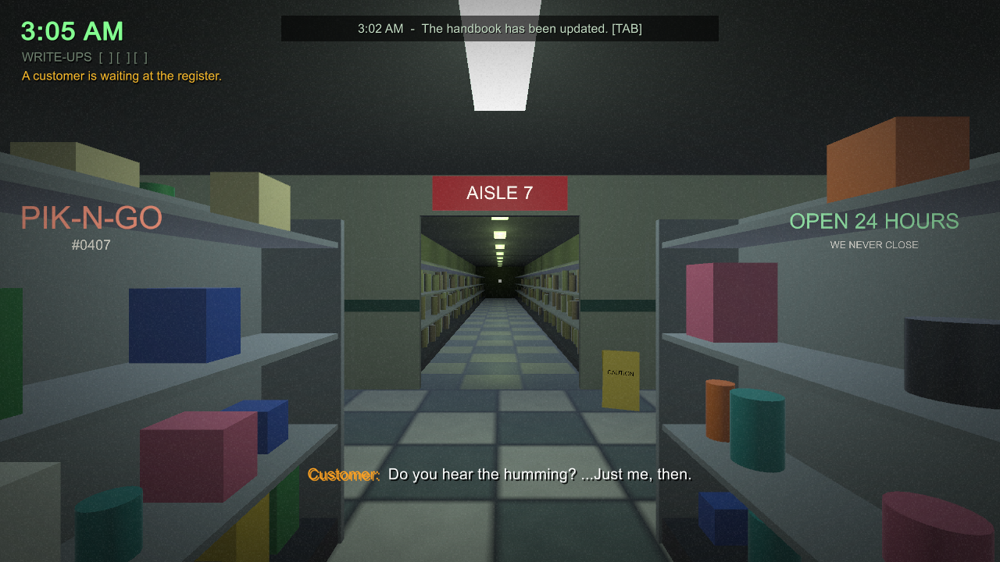

# AISLE SEVEN

*A night-shift horror game at PIK-N-GO #0407, where the customers get progressively stranger, and whatever's in aisle seven definitely isn't covered by your training.*

Made for **[GitHub Game Off 2026](https://itch.io/jam/game-off-2026)**. Theme: **SHIFT**.



## How it plays

You are Riley, working the graveyard shift from **11:00 PM to 6:00 AM**. Customers come to the register. Ring them up, or refuse the sale, by checking each one against the **Night Staff Handbook**.

The handbook gets a new page every hour, and the new rules don't always agree with the old ones (*when two rules disagree, the higher number wins*). Count the eyes. Listen to what they call you. Check what they pay with.

Sometimes the PA calls a cleanup in **aisle seven**. It's through the doorway at the end of aisle four, it's longer every hour, and the thing standing at the end of it only moves while it isn't seen.

Three write-ups and you're off nights. You don't want to be off nights.

### How it uses the theme

- **The night shift.** You're on the graveyard shift.
- **Shifting rules.** The handbook changes every hour, so what was safe at midnight gets you written up at 3 AM.
- **A shifting store.** Aisle seven gets longer, aisle signs change when you aren't looking, and the store gets darker.
- **The Shift key.** Never *SHIFT* (sprint) in aisle seven.
- **Shift change.** Find out at 6 AM who's taking over.

## Controls

| Key | Action |
|---|---|
| WASD | Move |
| Mouse | Look |
| E | Interact: register, phone, items |
| 1 / 2 | Ring up / refuse sale |
| TAB (or H) | Handbook |
| F | Flashlight (battery recharges while off) |
| Shift | Sprint (not in aisle seven) |
| Esc | Pause (`[` / `]` change mouse sensitivity) |

## Tech

- Unity **6000.4.3f1**, Built-in Render Pipeline, no third-party packages.
- **No imported assets.** All geometry is built at runtime from primitives, all audio (hum, drone, beeps, stingers, phone) is synthesized in code, and all UI is drawn with IMGUI.
- The whole game is built from the command line:

```bash
# one-time: materials, scene, player settings
Unity -batchmode -quit -projectPath AisleSeven -executeMethod BuildScript.Setup
# web build for itch.io -> Builds/WebGL
Unity -batchmode -quit -projectPath AisleSeven -buildTarget WebGL -executeMethod BuildScript.BuildWebGL
# windows build -> Builds/Windows
Unity -batchmode -quit -projectPath AisleSeven -buildTarget Win64 -executeMethod BuildScript.BuildWindows
```

Automated screenshot tour, used to check a build: `AisleSeven.exe -autoshot <folder>`.

### Code map

| File | What it does |
|---|---|
| `GameBootstrap.cs` | The only object in the scene. Builds everything. |
| `GameManager.cs` | Clock, hours, customers, write-ups, events, endings |
| `Rules.cs` | The handbook and the refuse/serve logic |
| `CustomerFactory.cs` / `Customer.cs` | Who walks in, what they look like, how they move |
| `Store.cs` | The store, its lights, signs, and the visitor at the window |
| `Aisle7.cs` | The growing corridor and the thing at the end of it |
| `HUD.cs` | All UI |
| `Core/Sfx.cs` | Procedural audio |

## License

MIT. See [LICENSE](LICENSE).
